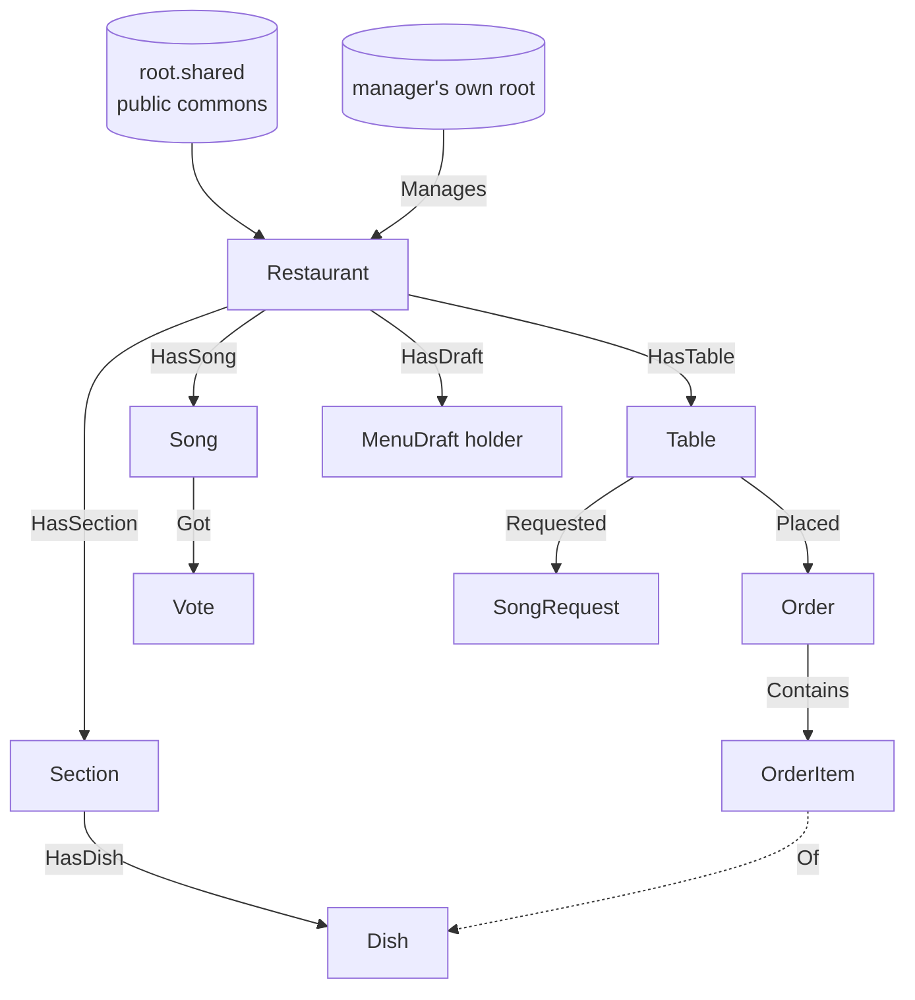

# TableTap AI: Data model

Jac stores data as a **graph**: nodes (things) joined by edges (connections). No database setup is needed; nodes attached to a root are saved automatically. Sources: `jac guide jac-node-edge-patterns`, `jac-sv-persistence`, `jac-sv-auth`, `jac-sv-multi-user`, `jac-by-llm` (jac 0.37.25).

## Diagram

## Nodes (saved data)

| Node | Fields | Notes |
|---|---|---|
| **Restaurant** | `name: str`, `slug: str` (e.g. `wet-water`), `music_mode: str` (`off`, `singer`, `speakers`, `both`), `menu_published: bool` | Lives on `root.shared` so anonymous guests can read it. One per manager |
| **Section** | `name: str`, `position: int` | e.g. "Seafood" |
| **Dish** | `name: str`, `price: int` (whole rupees, e.g. 990), `description: str`, `tags: list[str]`, `is_veg: bool`, `allergens: list[str]` (`shellfish`, `fish`, `nuts`, `egg`, `dairy`, `gluten`), `spicy: bool`, `sold_out: bool`, `needs_check: bool`, `photo_url: str` (optional), `position: int` | `needs_check` = agent was unsure → "Please check" |
| **Table** | `label: str` (e.g. "Table 5"), `code: str` (short random code used in the table link) | Tables 1 to 8 in starting data |
| **Order** | `status: str` (`sent`, `preparing`, `ready`), `allergy_note: str`, `created_at: str`, `via_ai: bool` | `via_ai` = planned by the AI waiter (nice for the demo and kitchen) |
| **OrderItem** | `dish_name: str`, `price: int`, `qty: int`, `note: str` | Name and price copied at order time, so later menu edits don't change old orders |
| **Song** | `title: str`, `artist: str`, `now_playing: bool` | The manager's approved list (speaker mode) |
| **Vote** | `table_code: str` | One per table per song; votes = number of Vote nodes on a Song |
| **SongRequest** | `song: str`, `artist: str`, `message: str`, `wish: str` (guest's original words), `status: str` (`pending`, `accepted`, `skipped`), `created_at: str` | Live singer mode; max 2 `pending` per table |

## Edges

| Edge | From → To | Meaning |
|---|---|---|
| `Manages` | manager's root → Restaurant | Which manager owns which restaurant |
| `HasSection` | Restaurant → Section | |
| `HasDish` | Section → Dish | |
| `HasTable` | Restaurant → Table | |
| `Placed` | Table → Order | |
| `Contains` | Order → OrderItem | |
| `HasSong` | Restaurant → Song | Approved list |
| `Got` | Song → Vote | |
| `Requested` | Table → SongRequest | |

Plain unnamed edges (`++>`) are fine where only one kind of connection exists; named edges make queries clearer.

## AI result objects (`obj`, not saved directly)

The guide says: *"LLM return types are `obj`s, never `node`s: have the LLM fill an `obj`, then copy fields into a `node` to persist."* So each agent returns one of these, and our code copies the result into nodes after a human confirms.

| obj | Fields | Used by |
|---|---|---|
| **DishDraft** | `section: str`, `name: str`, `price: int`, `description: str`, `is_veg: bool`, `spicy: bool`, `allergens: list[str]`, `confident: bool` | Menu Setup Agent |
| **MenuDraft** | `restaurant_name: str`, `dishes: list[DishDraft]` | Menu Setup Agent (from the photos) |
| **PlanItem** | `dish_name: str`, `qty: int`, `reason: str` | AI Waiter |
| **WaiterPlan** | `items: list[PlanItem]`, `total: int`, `summary: str`, `warnings: list[str]` | AI Waiter |
| **SongPick** | `song: str`, `artist: str`, `message: str`, `from_approved_list: bool` | AI DJ |

Every field gets a `sem` description so the AI knows what to fill in.

## Who can read and change what (access)

Based on `jac-sv-auth` and `jac-sv-multi-user`:

| Who | How they connect | Can do |
|---|---|---|
| **Manager** | Logged in → `def:protect` functions run on their own root | Create their Restaurant on `root.shared`, edit menu, publish, manage songs. Owns the Restaurant and everything under it |
| **Kitchen and music screens** | Same manager login on another device (simplest for one day) | Change order status, sold out, accept/skip requests, now playing |
| **Guest** | No login → `def:pub` functions; anonymous callers run on `root.shared` | Read the published menu, place orders, send song requests, vote |

Access rules to apply (from the guide):
- `grant(node, level=AccessLevel.READ)` on Restaurant, Section, Dish, Song, so every guest can read them.
- `grant(table, level=AccessLevel.CONNECT)` on each Table, so guests can attach Orders and SongRequests under it.
- `grant(song, level=AccessLevel.CONNECT)` on each Song, so guests can attach Votes.
- Orders and SongRequests created by guests get `grant(..., level=AccessLevel.WRITE)`, so the kitchen and singer (the manager) can change their status.
- Owner checks for manager-only actions are plain `if` checks, like tiny_jacyac.

## Starting data (S-01)
- Restaurant "Wet Water Resort", slug `wet-water`, music mode `both`, menu published.
- 6 sections and 35 dishes from the Wet Water menu (prices in whole rupees). Tags filled in sensibly (for example all Seafood dishes with prawns or cuttlefish → `shellfish`; Devilled dishes → spicy; Vegetable section → veg).
- Tables 1 to 8.
- 8 approved demo songs (title, artist): Perfect, Ed Sheeran · Can't Help Falling in Love, Elvis Presley · A Thousand Years, Christina Perri · Happy, Pharrell Williams · Uptown Funk, Mark Ronson ft. Bruno Mars · Celebration, Kool & the Gang · Despacito, Luis Fonsi · Manike Mage Hithe, Yohani. Nethma can change these in the manager's song list.
- Table codes are fixed: `t1` … `t8` (demo links never change; `/t/t5` = Table 5).
- Allergen notes: Wattalapan = egg, dairy, nuts (cashew); batter dishes = egg, gluten; noodles, spaghetti, macaroni = gluten; Chocolate Mousse = egg, dairy; Mixed dishes = shellfish. Vegetarian = no meat or fish (egg/dairy dishes can be veg but always list egg/dairy).
- **Who creates it:** `def:protect claim_demo_restaurant()` when the manager's dashboard opens, only if no Restaurant exists, so it is owned by the manager. Guests never trigger seeding.
- Created only if no Restaurant exists yet, so it never duplicates.

## Menu reference (Wet Water Resort, LKR)
- **Rice, Pasta & Noodles:** Vegetable Fried Rice 750 · Chicken Fried Rice 850 · Seafood Fried Rice 950 · Mixed Fried Rice 950 · Vegetable Fried Noodles 850 · Chicken Fried Noodles 950 · Seafood Fried Noodles 1050 · Mixed Fried Noodles 1050 · Spaghetti Bolognaise (Beef Sauce) 750 · Macaroni Topped With Cheese 750
- **Vegetable:** Vegetable Chop Suey 700 · Hot Batter Mushroom 530 · Assorted Butter Vegetable 690
- **Meat & Poultry:** Chicken Pepper Stew 680 · Singapore Fried Chili Chicken 780 · Devilled Chicken 680 · Sweet & Sour Chicken 740 · Half Roast Chicken With Boiled Vegetable 990 · Beef Stew 850 · Devilled Beef 830 · Pork Black Curry 700 · Pork Pepper Stew 750 · Devilled Pork 750
- **Seafood:** Fried Fish In Hot Garlic Sauce 790 · Devilled Fish 790 · Fish Pepper Stew 790 · Devilled Prawns 990 · Prawns Curry With Murunga Leaves 990 · Hot Batter Cuttlefish 850 · Devilled Cuttlefish 830
- **Desserts:** Wattalapan 230 · Chocolate Mousse 280
- **Beverages:** Sprite 150 · Coca-Cola 150 · EGB 150
